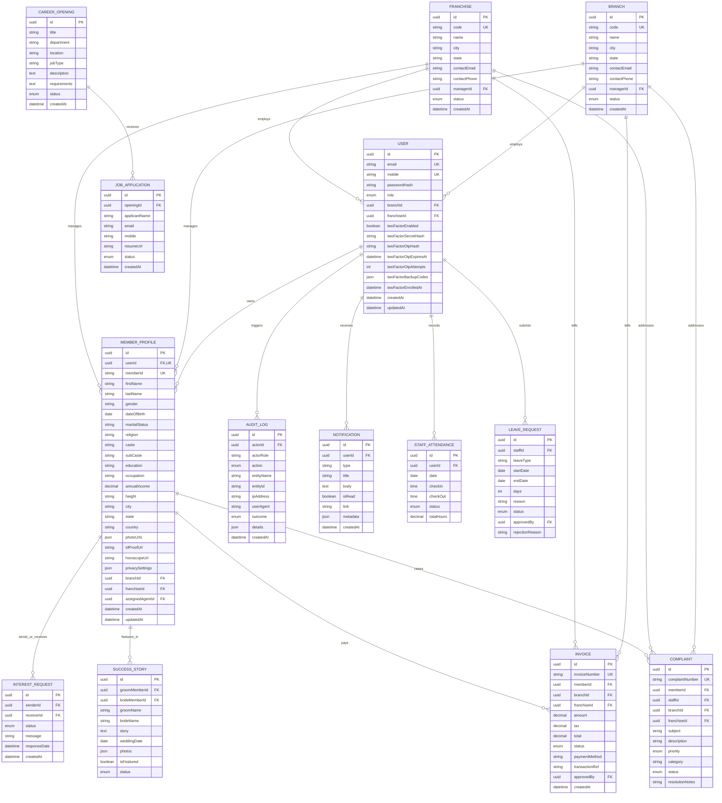

# Partner Matching Platform — Database Schema & ERD

> **Document Version:** 1.0.0  
> **Classification:** Confidential / Database Specification Deliverable  
> **Database Engine:** PostgreSQL 15+ (Hosted on Supabase)  
> **ORM Layer:** Prisma ORM 5.x

---

## 1. Database Architecture & Overview

The persistence tier is built on **PostgreSQL 15+** managed via **Supabase**. The database incorporates relational integrity constraints, foreign key cascades, specialized indexes on high-throughput lookup fields (such as `memberId`, `email`, `mobile`, `caste`, `gender`, `maritalStatus`), and strict role-based row scoping.

### Connection Architecture
- **Supavisor Transaction Pooler (`PORT 6543`):** Utilized by application runtime for connection pooling and auto-scaling.
- **Direct Session Connection (`PORT 5432`):** Reserved for administrative migrations (`prisma db push`, `prisma migrate`).

---

## 2. Entity-Relationship Diagram (ERD)

---

## 3. Detailed Data Dictionary

### 3.1 `User`
The primary authentication and identity table managing all platform roles.
- `id` (UUID, Primary Key): Unique internal user identifier.
- `email` (VARCHAR, Unique, Nullable): Registered email address.
- `mobile` (VARCHAR, Unique, Required): 10-digit mobile number used for primary communication.
- `passwordHash` (VARCHAR, Required): Work-factor 12 bcrypt password hash.
- `role` (ENUM, Required): One of `SUPER_ADMIN`, `ADMIN`, `BRANCH_MANAGER`, `FRANCHISE_MANAGER`, `BRANCH_STAFF`, `FRANCHISE_STAFF`, `BRANCH_AGENT`, `FRANCHISE_AGENT`, `MEMBER`.
- `branchId` (UUID, Foreign Key -> `Branch.id`, Nullable): Assigned branch affiliation.
- `franchiseId` (UUID, Foreign Key -> `Franchise.id`, Nullable): Assigned franchise affiliation.
- `twoFactorEnabled` (BOOLEAN, Default: false): Whether 2FA is active. Enforced unconditionally for `SUPER_ADMIN` and `ADMIN`.
- `twoFactorSecretHash` (VARCHAR, Nullable): Encrypted/hashed secret.
- `twoFactorOtpHash` (VARCHAR, Nullable): Salted bcrypt hash of the active 6-digit verification code.
- `twoFactorOtpExpiresAt` (TIMESTAMP, Nullable): OTP validity window (5 minutes).
- `twoFactorOtpAttempts` (INT, Default: 0): Counter tracking consecutive failures (locked at 3).
- `twoFactorBackupCodes` (JSONB, Nullable): Array of 5 bcrypt-hashed single-use 8-character recovery codes.
- `twoFactorEnrolledAt` (TIMESTAMP, Nullable): Timestamp of initial 2FA enrolment.

### 3.2 `MemberProfile`
Comprehensive demographic, astrological, and preference repository for matrimonial profiles.
- `id` (UUID, Primary Key): Unique profile record ID.
- `userId` (UUID, Foreign Key -> `User.id`, Unique): 1-to-1 link to user authentication record.
- `memberId` (VARCHAR, Unique): Human-readable identification code formatted as `M[YYYY][SERIAL]` (e.g., `M2026000001`).
- `firstName`, `lastName` (VARCHAR): Legal name of the member.
- `gender` (VARCHAR): `Male` or `Female`.
- `dateOfBirth` (DATE): Date of birth for age calculation and automated birthday wishes.
- `maritalStatus` (VARCHAR): `Unmarried`, `Divorced`, `Widowed`.
- `religion`, `caste`, `subCaste` (VARCHAR): Matrimonial classification fields.
- `education`, `occupation`, `annualIncome` (VARCHAR / NUMERIC): Professional profile data.
- `city`, `state`, `country` (VARCHAR): Geographical location.
- `photoUrls` (JSONB): Array of uploaded profile photographs.
- `idProofUrl` (VARCHAR): Private storage reference for identity verification document (Aadhaar/Passport).
- `horoscopeUrl` (VARCHAR): Private storage reference for Jathakam / Kundali charts.
- `privacySettings` (JSONB): Granular settings controlling contact phone visibility, photo blurring, and profile searchability.

### 3.3 `AuditLog`
Central immutable audit record enforcing accountability across critical operations.
- `id` (UUID, Primary Key): Unique log entry ID.
- `actorId` (UUID, Nullable): User ID of the operator performing the action.
- `actorRole` (VARCHAR, Nullable): Role of the actor at the moment of execution.
- `action` (ENUM): Actions include `LOGIN`, `FAILED_LOGIN`, `PROFILE_VIEW`, `PROFILE_EDIT`, `MEMBER_DATA_DOWNLOAD`, `TWO_FACTOR_SETUP`, `TWO_FACTOR_VERIFY`, `TWO_FACTOR_RECOVERY`, `ROLE_CHANGE`, `SECURITY_CONFIG`.
- `entityName` (VARCHAR): Name of the affected resource (`MemberProfile`, `User`, `Invoice`, etc.).
- `entityId` (VARCHAR): Identifier of the target record.
- `ipAddress` (VARCHAR): Client IP address (captured via reverse proxy `X-Forwarded-For`).
- `userAgent` (VARCHAR): Client browser/application user-agent string.
- `outcome` (ENUM): `SUCCESS`, `DENIED`, `FAILED`.
- `details` (JSONB): Metadata omitting sensitive passwords, tokens, or personal identifiers.
- `createdAt` (TIMESTAMP, Default: `now()`): UTC timestamp of the audited event.

---

## 4. Referential Integrity & Security Constraints

1. **Foreign Key Integrity:** Deleting a `Branch` or `Franchise` will not cascade-delete `MemberProfile` or `Invoice` records (`onDelete: Restrict`) to preserve financial and historical accountability.
2. **Contact Isolation:** Member phone numbers and identity documents are stored in normalized columns and are never queried during anonymous profile browsing queries.
3. **Index Strategy:**
   - Composite index on `MemberProfile(gender, maritalStatus, caste)` for optimal search latency.
   - Unique indexes on `User(mobile)` and `User(email)`.
   - Index on `AuditLog(action, createdAt)` and `AuditLog(actorId)` for fast compliance reporting.
