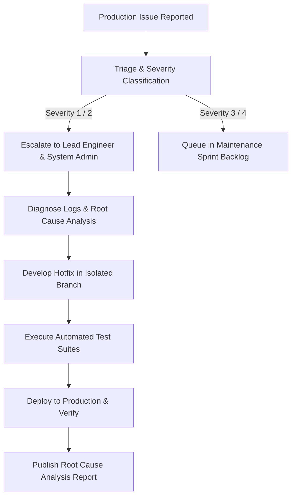

# Partner Matching Platform — 10-Year Post-Handover Maintenance Plan

> **Document Version:** 1.0.0  
> **Classification:** Operational Support & Maintenance Agreement Framework  
> **Maintenance Horizon:** Minimum 10 Years Post-Handover (as required by Specification Section 12.3)

---

## 1. Maintenance Scope & Objectives

The purpose of this plan is to ensure the long-term reliability, security, compliance, and performance of the Partner Matching Platform throughout its 10-year post-handover operational lifespan.

### Key Maintenance Pillars
1. **Security Patching & Vulnerability Management:** Regular audits and automated dependency vulnerability scans.
2. **Database Integrity & Backup Governance:** Proactive health monitoring and semi-annual non-destructive restoration drills.
3. **Defect Rectification (Bug Fixes):** Systematic handling of software defects reported in production.
4. **Minor Enhancements:** Controlled deployment of non-breaking features, optimizations, and compatibility updates.

---

## 2. Bug Severity & Response SLAs

Defects discovered during production operation are classified into four severity tiers:

| Severity Level | Definition | Target Initial Response | Target Resolution / Workaround |
|---|---|:---:|:---:|
| **Critical (Severity 1)** | Core platform outage; member login failure; security breach or data leak; financial transaction processing down. | Within 2 Hours | Within 8 Hours |
| **Major (Severity 2)** | Major module malfunction (e.g., search not returning matches, SMS/Email OTP delivery failing) with no immediate workaround. | Within 6 Hours | Within 24 Hours |
| **Minor (Severity 3)** | Non-critical functionality defect (e.g., cosmetic UI misalignment, PDF biodata layout formatting glitch) with acceptable workaround. | Within 24 Hours | Within 5 Business Days |
| **Cosmetic (Severity 4)** | Typographical error, minor styling enhancement, or documentation clarification. | Within 48 Hours | Next Scheduled Release |

> *Note:* Specific financial penalties, binding SLAs, and dedicated on-call engineering hours must be formalized in the separate commercial Annual Maintenance Contract (AMC).

---

## 3. Security Patching & Dependency Update Lifecycle

### 3.1 Monthly Dependency Audits
- Execute automated dependency vulnerability auditing:
  ```bash
  npm audit
  ```
- Review security advisories regarding Node.js runtime, NestJS, Prisma, and React dependencies.
- Apply semantic patch upgrades (`x.y.Z`) without breaking API contracts.

### 3.2 Operating System & Runtime Upgrades
- Monitor official LTS lifecycles for Node.js (e.g., Node 20 LTS -> Node 22 LTS).
- Conduct compatibility regression tests across all automated test suites (`npm run test:security`, etc.) prior to bumping runtime versions in production.

---

## 4. Database Backup Monitoring & Restoration Drills

1. **Daily Backup Verification:** Automated verification script confirms that daily database dumps or Supabase Point-in-Time Recovery (PITR) points are successfully created.
2. **Semi-Annual Restoration Testing:** Every 6 months, a restoration drill is conducted in an isolated staging environment using a sanitized backup file.
3. **Storage Space Management:** Backup archives exceeding the 30-day retention window are automatically pruned to prevent uncontrolled storage cost growth.

---

## 5. Incident Response & Escalation Matrix



### Escalation Hierarchy
1. **Tier 1 (Helpdesk / Operations Lead):** Initial verification, gathering member details or error screenshots.
2. **Tier 2 (Application Support Engineer):** Code-level diagnosis, database query investigation, reproducing issue.
3. **Tier 3 (Lead Architect / DevOps Engineer):** Core architectural hotfixes, database failover, infrastructure security remediation.

---

## 6. Annual Review & Handover Milestones

An annual review meeting shall be convened between the Platform Owner and the Maintenance Provider to evaluate:
- Total uptime and SLA compliance over the preceding 12 months.
- Number of defects resolved categorized by severity.
- Storage and database consumption projections for the upcoming year.
- Review of upcoming regulatory changes (such as data privacy mandates or GST invoice rules).

---

## 7. Items Requiring Separate Commercial Agreement

As mandated by Section 12.3 of the Project Specification, the following operational and financial parameters are subject to separate negotiation between the platform owner and provider:

- **Annual Maintenance Fees (AMC):** Baseline fee structure and payment frequency.
- **Dedicated Standby Support Hours:** Availability of 24/7 emergency phone hotlines vs. standard business hour ticketing.
- **Major Feature Enhancements:** New module additions outside the original 12 sections are billed separately.
- **Third-Party Infrastructure Costs:** Server hosting, Supabase subscription tiers, SMS/WhatsApp credits, and domain certificates remain the financial responsibility of the platform owner.
