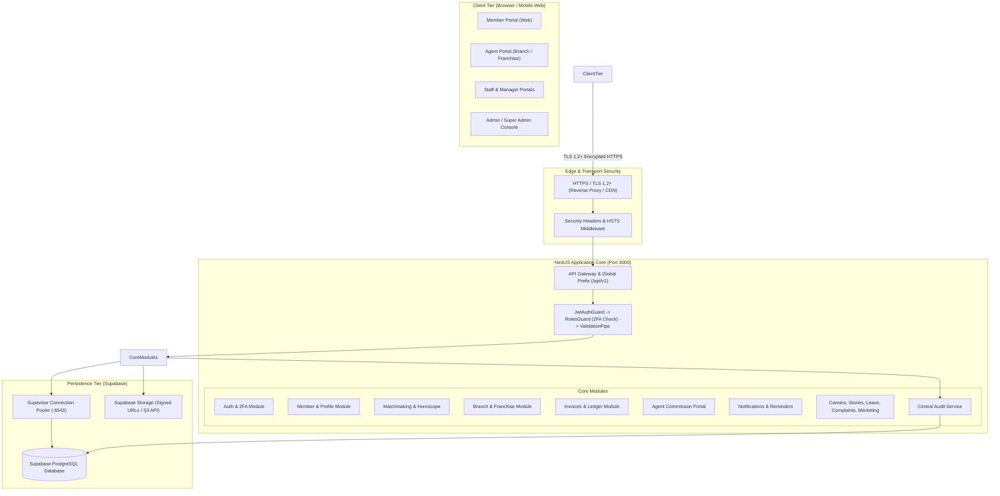
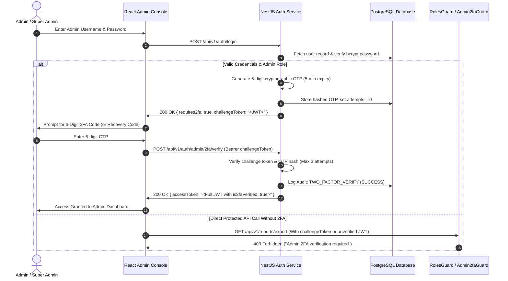

# Partner Matching Platform — Technical Architecture Document

> **Document Version:** 1.0.0  
> **Classification:** Confidential / System Architecture Deliverable  
> **Target Audience:** System Architects, Lead Engineers, Security Auditors, and DevOps Teams

---

## 1. System Overview & Executive Summary

The **Partner Matching Platform** is a secure, enterprise-grade matrimonial matchmaking platform architected specifically for Telugu communities. The system supports multi-tier organizational hierarchies, strict role-based access control (RBAC), fine-grained contact privacy rules, automated matchmaking algorithms, real-time communications, marketing attribution, and comprehensive administrative governance.

### High-Level Architectural Principles
1. **Separation of Concerns:** Clean boundary between the presentation tier (Single Page Application in React/Vite), application logic tier (Modular NestJS REST API), and managed persistence tier (Supabase PostgreSQL via Supavisor pooler).
2. **Defense in Depth:** Multi-layered security spanning HTTP security headers, CORS origin verification, JWT stateless authentication, mandatory Two-Factor Authentication (2FA) for administrative accounts, role guards, parameter-level tenant isolation (branch/franchise scoping), and database Row-Level Security (RLS).
3. **Data Integrity & Traceability:** Immutable audit logging for sensitive actions (logins, profile views, record edits, exports, security setting changes) and referential integrity enforced via relational foreign keys.

---

## 2. Technology Stack

### 2.1 Frontend Tier
- **Framework:** React 18.2 with TypeScript
- **Bundler & Tooling:** Vite 8.x / ESBuild
- **Routing:** React Router DOM (v6) with declarative route guards (`AdminRoute`, `AgentRoute`, `StaffRoute`, `MemberRoute`)
- **State Management & Networking:** Custom reactive service architecture using typed Axios HTTP client with auto-refresh token handling and session storage
- **Styling:** Vanilla Modular CSS adhering to Telugu cultural aesthetics (Deep Crimson `#800020`, Royal Gold `#d4af37`, Slate `#1e293b`), fully responsive across mobile, tablet, and desktop viewports
- **Marketing Integration:** Asynchronous Facebook Pixel, Google Tag Manager event dispatchers, and URL attribution capture

### 2.2 Backend Tier
- **Framework:** NestJS 10.x (Node.js LTS runtime)
- **Architecture:** Domain-Driven Modular Monolith with Dependency Injection
- **Validation & Transformation:** `class-validator` and `class-transformer` for strict runtime request DTO validation
- **Authentication & Security:** 
  - `@nestjs/jwt` and `@nestjs/passport` for stateless JSON Web Tokens
  - `bcrypt` with work factor 12 for password hashing and emergency recovery code storage
  - Express-level security middleware (HSTS, X-Content-Type-Options, X-Frame-Options, Referrer-Policy, HTTPS redirection)
  - Custom RBAC decorators (`@Roles()`) and Guards (`JwtAuthGuard`, `RolesGuard`, `Admin2faGuard`)
- **Audit Engine:** Centralized audit service recording structured actor, action, IP, and timestamp events

### 2.3 Persistence & Storage Tier
- **Database:** PostgreSQL 15+ managed via Supabase
- **Connection Architecture:**
  - Supavisor Transaction Pooler (`PORT 6543`) for high-concurrency API request handling
  - Direct Session Connection (`PORT 5432`) for Prisma migrations and schema push
- **ORM:** Prisma ORM 5.x with type-safe schema definitions and automated client generation
- **File Storage:** Supabase Storage (Private and Public buckets) with signed short-lived URLs for sensitive identification documents (Aadhaar, PAN, Biodata PDFs)

---

## 3. High-Level Architecture Diagram

---

## 4. Authentication & Authorization Flow

### 4.1 Member Authentication Flow
1. Member supplies credentials (Member ID / Mobile / Email + Password) OR verifies via 6-digit Mobile/Email OTP.
2. Backend validates password against bcrypt hash OR verifies OTP against active expiry window with rate-limiting.
3. Upon success, backend issues a signed JWT (`accessToken`) with 24-hour expiration, containing `sub`, `role: 'MEMBER'`, and `memberId`.
4. Member accesses member-scoped endpoints guarded by `JwtAuthGuard`.

### 4.2 Mandatory Admin & Super Admin 2FA Flow

### 4.3 Emergency Backup Recovery Code Flow
- During admin setup, 5 unique 8-character cryptographic recovery codes are generated and stored as individual bcrypt work factor 12 hashes (`twoFactorBackupCodes`).
- If an admin loses their physical device, they can invoke `POST /api/v1/auth/admin/2fa/recovery`.
- The matching code is consumed (removed from the array in the database), preventing replay attacks, and the session is authenticated with audit trail logging.

---

## 5. Role-Based Access Control (RBAC) Matrix

| Module / Operation | Super Admin | Admin | Branch Manager | Franchise Manager | Staff | Agent | Member |
|---|:---:|:---:|:---:|:---:|:---:|:---:|:---:|
| **Admin 2FA Required** | Yes | Yes | No | No | No | No | No |
| **Member Data Bulk Export (CSV/PDF)** | **Allowed** | **Allowed** | **Denied (403)** | **Denied (403)** | **Denied (403)** | **Denied (403)** | **Denied (403)** |
| **View Full Member Profile** | All | All | Scoped Branch | Scoped Franchise | Scoped | Assigned | Privacy Rules |
| **Reveal Contact Details** | Full | Full | Branch (Paid) | Franchise (Paid) | Branch | Assigned | Explicit Consent |
| **Branch / Franchise Config** | Full | Full | Read-Only Own | Read-Only Own | None | None | None |
| **Invoice Approval / Billing** | Full | Full | Branch Only | Franchise Only | None | Commission Only | Own Invoices |
| **Staff & Leave Approvals** | Full | Full | Branch Staff | Franchise Staff | Own Leave | None | None |
| **Complaints Management** | Full | Full | Scoped Branch | Scoped Franchise | Assigned | None | Own File |
| **Audit Log Inspection** | **Full** | **Full** | **Denied** | **Denied** | **Denied** | **Denied** | **Denied** |

---

## 6. External Service Integrations

| Service Type | Provider / Protocol | Implementation Details | Failure Mode & Fallback |
|---|---|---|---|
| **Database** | Supabase PostgreSQL 15 | Managed PostgreSQL over Supavisor pooler | Pooled retry with exponential backoff |
| **Document Storage** | Supabase Storage API | Signed expiring URLs (max 15 mins) for sensitive KYC | Private bucket fallback; access denied if unauthenticated |
| **SMS Gateway** | Webhook / REST Gateway | Dynamic template injection for OTP and alerts | Simulated safe dev logging when unconfigured |
| **Email Gateway** | SMTP / Webhook API | HTML transaction templates for billing and matchmaking | Safe logging when omitted |
| **WhatsApp Business** | Cloud API (Meta) | Graph API endpoint for high-priority birthday & match alerts | Fallback to SMS / in-app notification |
| **Marketing Pixels** | Meta Pixel & GTM | Client-side async event tracking for registration funnels | Silent failure; does not block UI flow |

---

## 7. Security Boundaries & Threat Modeling

1. **API Perimeter:** All incoming API traffic passes through global CORS validation against configured `ALLOWED_ORIGINS`, JSON body parsers with a 10MB limit to prevent memory exhaustion, and helmet-equivalent security headers.
2. **Database Isolation:** PostgreSQL connection strings use least-privilege credentials for standard operations. Direct superuser connections are restricted strictly to migrations.
3. **Sensitive Document Shielding:** Government ID proofs (Aadhaar, PAN), income certificates, and confidential astrological charts are never saved in public buckets or returned as raw binary over open endpoints.
4. **Member Data Leakage Protection:** Endpoints producing CSV or PDF exports of member rosters are guarded at both controller and service levels, strictly rejecting non-admin tokens.
